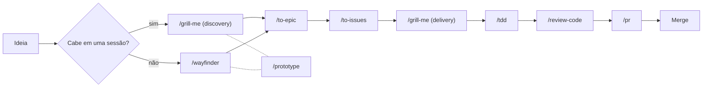

# skills

Uma coleção de [Agent Skills](https://docs.claude.com/en/docs/claude-code/skills) para ferramentas de agente (ex: Claude Code, Codex), construída em torno de um workflow de entrega de software orientado a domínio: transformar um problema em um épico, um épico em issues verticais, uma issue em código testado e revisado, e código em um PR mergeável.

Marketplace `skills` com um plugin, `fst`. Os comandos levam o nome do plugin como prefixo, ex.: `/fst:tdd`; o autocomplete já reconhece a skill ao digitar apenas o nome dela.

## Skills

| Comando                   | Para quê                                                                                                                                                | Classificação |
|---------------------------|---------------------------------------------------------------------------------------------------------------------------------------------------------|---------------|
| `/fst:grill-me`           | Confronta plano de discovery/delivery com o domínio até fechar um consenso; atualiza glossário com terminologia do domínio e ADRs com decisões técnicas | HITL          |
| `/fst:prototype`          | Gera um Protótipo de código descartável para responder a uma pergunta de design (de lógica complexa em código ou de UI)                                 | HITL          |
| `/fst:to-epic`            | Sintetiza o contexto da conversa em um épico, sem entrevistar o usuário                                                                                 | AFK           |
| `/fst:to-issues`          | Deriva o épico em issues GitHub por fatias verticais (_tracer bullets_)                                                                                 | HITL          |
| `/fst:wayfinder`          | Gera um mapa de issues GitHub para um trabalho maior que 1 sessão (para tarefas de 1 sessão, use grill-me)                                              | HITL / AFK    |
| `/fst:tdd`                | Implementa uma issue seguindo TDD (Red-green-refactor)                                                                                                  | HITL / AFK    |
| `/fst:pr`                 | Gera um corpo de PR seguindo o template do projeto, com plano de QA ponta-a-ponta para o diff informado ou calculado                                    | AFK           |
| `/fst:review-code`        | Revisa o código do diff como arquiteto sênior, referenciando CAs da issue e as diretrizes do projeto                                                    | AFK           |
| `/fst:handoff`            | Compacta a conversa em documento de handoff para outro agente continuar (evita alucinações)                                                             | AFK           |
| `/fst:teach`              | Ensina o usuário sobre um tópico dentro do projeto, ao longo de múltiplas sessões e lições persistentes                                                 | HITL          |
| `/fst:writing-for-agents` | Escreve skills, `AGENTS.md` e outros docs consumidos por agentes                                                                                        | AFK           |

### Legenda de classificação

- **HITL (Human In The Loop)**: a skill não consegue terminar sem um ponto de decisão humana (responder perguntas, aprovar um plano ou rascunho, fechar um consenso).
- **AFK (Away From Keyboard)**: a skill roda de ponta a ponta com o contexto que recebe e produz um artefato finalizado sem esperar pelo usuário.
- **HITL / AFK**: um híbrido — parte da skill roda autonomamente (ex: um tracer bullet, um ciclo RED/GREEN) enquanto outra parte exige um checkpoint humano explícito (ex: edge cases, o plano de teste).

> **Todas essas skills são iniciadas pelo usuário.** Descrições como "use quando o usuário quiser..." descrevem *quando um humano deve invocar a skill* (ex: via `/tdd`, `/grill-me`) — nenhuma delas deve disparar autonomamente no meio de uma conversa sem ser explicitamente solicitada. Dito isso, o LLM pode sugerir proativamente uma dessas skills, e você pode continuar a sessão invocando-a.

## Workflow interdisciplinar

Essas skills foram desenhadas para serem encadeadas ao longo da vida de uma funcionalidade, de uma ideia de tamanho indefinido a um PR mergeado:



1. **Discovery**: desafie o framing do problema e os limites do MVP. Quando pesquisa, grilling e prototipagem cabem todos em uma sessão (ou em uma cadeia curta delas), conduza com `grill-me`, recorrendo a `prototype` sempre que uma questão de design precisar de um artefato concreto para reagir — cada sessão retoma a anterior através de um `HANDOFF.md` gerado por `/handoff`. Quando o esforço é grande demais para isso — mais decisões em aberto do que uma sessão ou uma cadeia curta de handoffs comporta — conduza o discovery com `wayfinder` em vez disso: ele mapeia as decisões como um mapa compartilhado de issues (tipadas como `research`, `prototype`, `grilling`, ou `task`) no issue-tracker e os resolve um de cada vez, com segurança entre sessões concorrentes. De qualquer forma, atualize o glossário do projeto com nova terminologia de domínio conforme as decisões se fecham, e depois sintetize o escopo acordado em um épico com `to-epic`.
2. **Decomposição**: quebre o épico em issues independentes, fatiadas verticalmente com `to-issues`.
3. **Planejamento de entrega**: antes de tocar em código para uma dada issue, rode `grill-me` novamente (modo entrega) para testar a resistência do plano técnico contra os ADRs e as convenções de nomenclatura.
4. **Implementação**: construa o comportamento test-first com `tdd` (red-green-refactor + testes de mutação).
5. **Review e entrega**: obtenha uma passada em nível sênior com `review-code`, depois gere o corpo do PR (descrição, escopo, orientações de revisão e plano de QA) com `pr`.

Considerações:

- **Continuidade**: sempre que uma sessão precisar terminar antes de a issue estar concluída (pressão de janela de contexto perto do limiar de 40% da capacidade, fim do dia, passando o trabalho para outra pessoa), `handoff` compacta a conversa em um doc dedicado para que a próxima sessão (ou agente) possa retomar exatamente naquele ponto sem precisar reconstruir do zero o contexto.
- `wayfinder` substitui `grill-me` apenas quando o trabalho ultrapassa uma única sessão (ou uma cadeia curta de `handoff`) — pesquisa, prototipagem e a própria conversa de grilling ainda acontecem, só que resolvidas issue a issue no mapa em vez de turno a turno em uma única thread. Abaixo desse limiar, `grill-me` e `prototype` iteram diretamente entre sessões, cada uma retomando a anterior via um `HANDOFF.md`.
- `handoff` não está atrelado a nenhuma etapa específica. Pode ser chamado de onde quer que a sessão termine: no meio de um `grill-me` enquanto o discovery ainda está sendo moldado, entre issues depois de `to-issues`, no meio de um `tdd` entre ciclos red/green, ou em qualquer outro ponto. É uma "válvula de escape" transversal para todo o workflow, não só uma etapa dele.
- `teach` também fica fora desse ciclo — não é uma etapa do workflow de entrega de software, e sim uma skill autônoma de aprendizado, usada em um workspace de ensino dedicado para adquirir uma habilidade ou conceito técnico qualquer ao longo de múltiplas sessões.
- `writing-for-agents` fica fora desse ciclo — é a referência consultada sempre que o time escreve ou edita uma skill, ou mexe em `AGENTS.md`/`CLAUDE.md`, para estender esta própria caixa de ferramentas.

---

## Instalação (por projeto)

1. **Registrar o marketplace**, uma vez por quem configura o projeto:

```bash
claude plugin marketplace add Franco904/skills --scope project
```

Commite o `.claude/settings.json` gerado. Ele registra o marketplace para quem confiar na pasta, mas **não instala o plugin**.

2. **Instalar o plugin**, uma vez por dev (inclusive quem configurou), depois de confiar na pasta do projeto:

```bash
claude plugin install fst@skills --scope project
```

Sem isso, a aba **Errors** do `/plugin` mostra `Plugin "fst" is enabled in project settings but isn't installed here`.

O auto-update vem desligado por padrão. Ative em `/plugin` > Marketplaces > `skills`, ou declare `"autoUpdate": true` na entrada do marketplace no `.claude/settings.json`.
Sem auto-update, use `/plugin marketplace update skills`.

Referências (documentação oficial do Claude Code):

- [Marketplace reference](https://code.claude.com/docs/en/plugins/marketplace-reference): campos do `marketplace.json`, tipos de `source` e mensagens de validação
- [Plugin manifest reference](https://code.claude.com/docs/en/plugins/manifest-reference): campos do `plugin.json`, regras de caminho e layout de diretórios
- [Plugin loading](https://code.claude.com/docs/en/plugins/loading): como o Claude Code carrega, versiona e atualiza plugins
- [Troubleshooting](https://code.claude.com/docs/en/plugins/troubleshooting): erros comuns de instalação e atualização

## Contrato com o projeto consumidor

As skills assumem que o projeto consumidor tem os seguintes artefatos para harness:

- `GLOSSARY.md`: Glossário da linguagem ubíqua do projeto.
- `docs/adr/`: Architecture Decision Records para decisões difíceis de reverter, surpreendentes sem contexto e não óbvias; nomeadas `NNNN-<slug>.md`. O diretório passa a existir a partir do 1º ADR adicionado.
- `docs/guidelines/`: Diretrizes de engenharia, nomeadas `NNNN-<slug>.md`. A pasta [`docs/guidelines/`](docs/guidelines/) deste repo traz **exemplos** de diretrizes.
- `.github/pull_request_template.md` (opcional): template usado por `pr`; sem ele, a skill usa o template genérico empacotado no plugin.

### Slugs de diretrizes

As skills identificam uma diretriz pelo **slug**, nunca pelo número: o prefixo `NNNN` é livre e só ordena. A skill localiza o arquivo por glob (`docs/guidelines/*-<slug>.md`) e ignora em silêncio a diretriz que não existir.

| Slug               | Usado por            | Observação                                           |
|--------------------|----------------------|------------------------------------------------------|
| `*-tests`          | `tdd`, `review-code` | Diretrizes de teste (ex.: `all-tests`, `unit-tests`) |
| `interface-design` | `tdd`                | Design de interfaces (+ Design It Twice)             |
| `comments`         | `tdd`                | Comentários                                          |
| `naming`           | `tdd`                | Nomenclatura                                         |

Regras:
- Toda diretriz de teste (`*-tests`) declara em `## Escopo` os arquivos a que se aplica; `review-code` só a aplica se o diff tocar esse Escopo.
- A diretriz `comments` deve ter a seção "Comentário primeiro"; `tdd` a usa para projetar as interfaces públicas.
- No `review-code`, toda diretriz que **não** termina em `-tests` (inclusive as de slug livre, como arquitetura) é critério de todo review.
